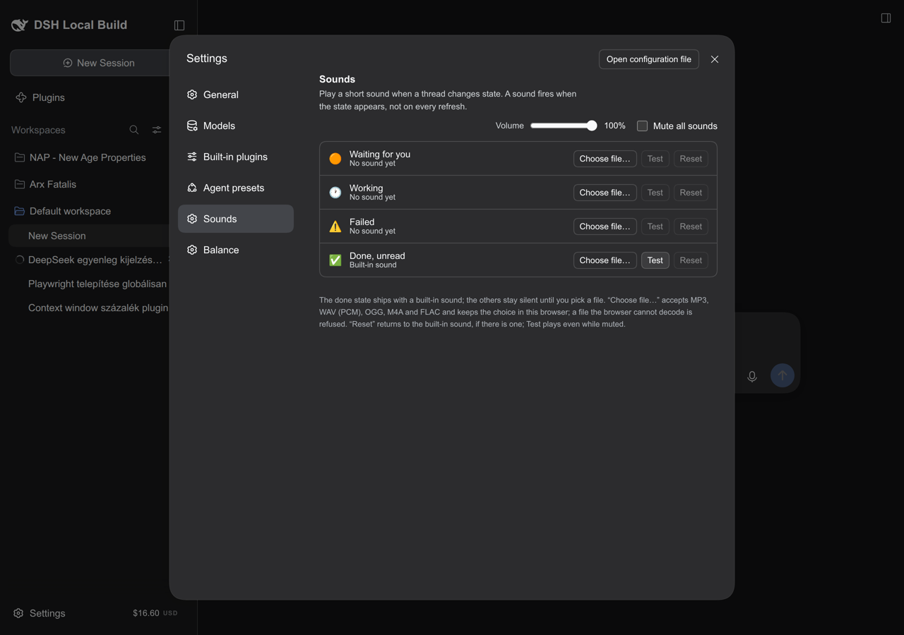

# dsh-title-indicator

A thread-status marker — and optional notification sounds — in the **DeepSeek
Harness Web GUI** browser tab title. Glance at the tab while you are in another
app and see whether something is running, broke, waits for you, or finished.

English · [Magyar](#magyar)

```
🟠  DeepSeek egyenleg kijel…       a thread waits for one click from you
🕐  DeepSeek egyenleg kijel…       some thread is working
⚠️  DeepSeek egyenleg kijel…       everything stopped, and a thread failed
✅  DeepSeek egyenleg kijel…       everything settled, one finished unread
    DeepSeek egyenleg kijel…       nothing to report
```

## What it shows

The marker leads the title the layout already owns (`Session — Product`); it is
a prefix, never a replacement, and the plugin strips its own marker before
composing so a later layout write cannot drop it.

| Priority | State | Marker | When |
|---|---|---|---|
| 1 | waiting for you | `🟠 ` | any thread has a pending interaction (approval, plan review, question) |
| 2 | working | `🕐 ` | any thread is running |
| 3 | failed | `⚠️ ` | nothing runs, and a thread stopped because a turn failed |
| 4 | done | `✅ ` | nothing runs, and a thread finished unread |

A pending interaction outranks everything: answering it usually takes one click
and the thread stays blocked until you do.

### "Stopped while I was away"

`⚠️` and `✅` only appear for a stop observed while the page was hidden or
unfocused — a finish you watched happen needs no shouting. Regaining attention
clears both markers. `🟠` does not wait for attention: a pending answer is worth
seeing from anywhere.

## Sounds

**Settings → Sounds** gives every state its own sound, plus a volume slider and a
mute switch. The **done** state ships with a built-in sound — a short *tada*
(`sounds/done.mp3`, 2.1 s) — and the other three stay silent until you pick a
file for them.



| Control | Behaviour |
|---|---|
| Choose file… | accepts MP3, WAV (PCM), OGG, M4A and FLAC; the browser's decoder is the judge, so an unsupported file (for example the ADPCM WAVs common in old games) is refused with a message and the previous choice stays |
| Test | plays immediately, even while muted |
| Reset | returns to the built-in sound, or clears the picked file when the state has none |
| Volume | 0–100 % in 10 % steps |
| Mute all sounds | suppresses state transitions (Test still works) |

- Sounds play on a state **change**, not on every refresh, and never on page
  load (work already running when you open the tab stays quiet).
- The pending sound rings for **every new pending interaction** — each approval,
  plan review or question gets its own cluck, even while the marker stays 🟠 for
  an earlier one.
- Choices live in this browser (IndexedDB): volume, mute and picked files are
  per browser profile.
- The tab title is re-asserted every 2 seconds and updated immediately on a
  state change; a `MutationObserver` keeps the marker when the layout rewrites
  the title.

## Install

From the Web GUI: **Plugins → Add plugin** and enter either this checkout's path
or the repository URL, then **Install → Enable now → F5**. The plugin manager
runs `git ls-remote` for a GitHub address before installing.

Or through the CLI:

```sh
dsh plugin --profile web add /path/to/dsh-title-indicator
# or a git address once published:
dsh plugin --profile web add git+https://github.com/meszaros-lajos-gyorgy/dsh-title-indicator.git
```

The bundle adds one Loader row; the same package declares `dsh.client`, so its
browser half arrives with the client module graph. **F5** after install; a
host-half change needs a DSH restart when HMR watches configuration only.

Remove it with **Plugins → disable/remove** (the marker is stripped from the
title on unload).

## How it works

| File | Role |
|---|---|
| `index.js` | host half: tracks the last committed `turn/end` reason per Session and serves it at `/plugins/dsh-title-indicator/status` |
| `client.js` | browser half: the invisible `shell.overlay` title projection plus the `settings.section` Sounds card |
| `cordis.patch.yml` | the bundle layer that inserts the `title-indicator` row |
| `test/client.test.mjs` | dependency-free tests for both halves (fake React, fake document, fake Context) |

The client knows whether a Session runs, waits or finished unread — but not
*why* it stopped. That is the one fact the host half adds: the `turn/end` reason,
including the provider-neutral failure code (a depleted API balance arrives as
`reason.kind === "error"`).

## Tests

```sh
node test/client.test.mjs
```

Covers the four precedence rules, marker composition and stripping, the
running→stopped transition, the failure window, the marker→sound mapping, the
sound manager (built-in done sound, volume grid, mute, `force` testing, file
screening, decode refusal, reset, IndexedDB mock), both slot registrations and the host route.

## Limitations

- The "away" signal is the page's visibility and window focus. A visible but
  unfocused window counts as away — deliberate, because you read the title from
  the tab strip then.
- Browsers throttle timers in hidden tabs (1/min, sometimes 1/5 min); the marker
  is still correct, only the 2-second re-assertion may lag.
- A subagent working in the background is usually visible through its parent's
  `running` flag; an idle parent with a running child follows the parent.
- The marker follows the `turn/end` reason, so a failure that was retried
  successfully inside the same turn does not raise `⚠️`.
- `/plugins/dsh-title-indicator/status` does not ask for the browser-session
  cookie (a client plugin cannot read it). Loopback-only use is fine; a web
  server bound to `0.0.0.0` should protect it.
- The host half keeps outcomes in memory (up to 512 Sessions); a host restart
  starts empty until the next `turn/end`.

## License

MIT — see [LICENSE](LICENSE).

## Magyar

Egy DSH plugin a Web GUI fülcíméhez: **állapotjelölő** (🟠 vár rád, 🕐 dolgozik,
⚠️ hiba, ✅ kész/olvasatlan) és opcionális **hangértesítés** állapotváltásra.

- A jelölő a layout címének elé kerül (`Session — Product`), fontossági sorrend:
  **🟠 > 🕐 > ⚠️ > ✅**.
- A `⚠️` és a `✅` csak akkor jelenik meg, ha a leállást távolról láttad (rejtett
  vagy fókusz nélküli lap); amikor visszatérsz, eltűnik.
- **Hangok**: Settings → Sounds, állapotonként egy fájl, hangerő (10%-os lépések)
  és némítás. A **kész (✅)** állapothoz van beépített hang (rövid *tada*,
  `sounds/done.mp3`, 2,1 s), a többi állapot csendes, amíg nem választasz fájlt.
  A 🟠 hang **minden új kérésnél** megszólal (nem csak akkor, amikor a jelölő
  megjelenik), a többi állapot váltáskor szól.
- Telepítés: **Plugins → Add plugin** a mappa útvonalával vagy a git címmel,
  majd **F5**.
- A hang és a hangerő a böngésződben marad (IndexedDB), másik böngészőben nem.
- Teszt: `node test/client.test.mjs`.

A részletes angol leírás fent található; a korlátok és a működés ugyanaz.
